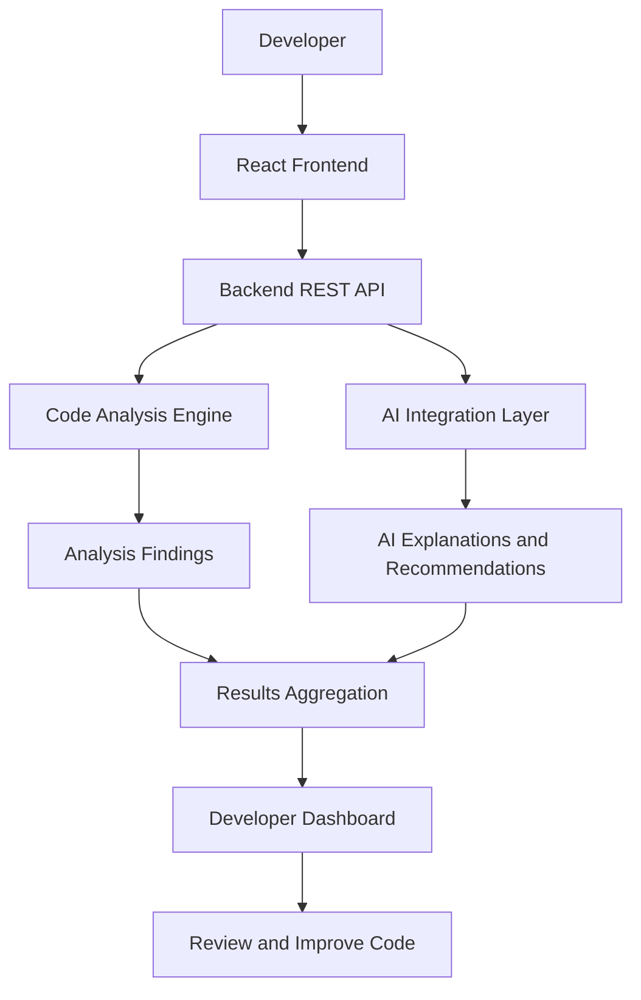

# 🛡️ CodeGuardian AI

### AI-Powered Code Review & Security Analysis Platform

**Write better code. Detect potential vulnerabilities. Build more secure software.**

CodeGuardian AI is an AI-powered developer tool designed to help developers analyze source code, identify potential security vulnerabilities, understand code-quality issues, and explore actionable improvements through an intuitive web interface.

By combining static code analysis with Generative AI, CodeGuardian AI aims to make code reviews more accessible, insightful, and developer-friendly.

<p align="center">
  <a href="https://github.com/sks993442/codeGuardian-AI">
    
  </a>
  
  
  
</p>

---

## 📌 Table of Contents

- [Overview](#-overview)
- [Why CodeGuardian AI?](#-why-codeguardian-ai)
- [Key Features](#-key-features)
- [How It Works](#-how-it-works)
- [System Architecture](#-system-architecture)
- [Technology Stack](#-technology-stack)
- [Getting Started](#-getting-started)
- [Environment Configuration](#-environment-configuration)
- [Project Structure](#-project-structure)
- [Security Considerations](#-security-considerations)
- [Roadmap](#-roadmap)
- [Contributing](#-contributing)
- [Author](#-author)

---

## 🚀 Overview

Code reviews are an essential part of software development, but manually identifying bugs, security weaknesses, and maintainability problems can be time-consuming.

**CodeGuardian AI aims to simplify this process.**

The platform brings together a web-based developer experience and AI-assisted code analysis to help developers better understand potential issues in their code.

The project focuses on three key areas:

- 🔍 **Code Analysis:** Examine source code for potential problems.
- 🛡️ **Security Awareness:** Identify suspicious patterns and potential vulnerabilities.
- 🤖 **AI-Assisted Recommendations:** Explain findings and explore possible improvements.

The long-term vision is to evolve CodeGuardian AI into a comprehensive code-review assistant that supports developers throughout the software development lifecycle.

## 💡 Why CodeGuardian AI?

| Traditional Code Review | CodeGuardian AI's Goal |
|---|---|
| Manual inspection can be time-consuming | Make analysis more efficient |
| Security findings can be difficult to understand | Provide clearer explanations |
| Beginners may struggle to fix detected issues | Offer actionable improvement suggestions |
| Code-quality checks may require multiple tools | Bring useful insights into one interface |

The goal is not to replace experienced developers or established security tools, but to **help developers make better-informed decisions about their code.**

## ✨ Key Features

### 🔍 1. AI-Assisted Code Analysis
Analyze source code and explore potential bugs, structural issues, and opportunities to improve code quality.

### 🛡️ 2. Security-Focused Review
Help identify potentially unsafe coding patterns and security concerns, such as:

- SQL injection risks
- Hardcoded credentials and exposed secrets
- Potential cross-site scripting (XSS)
- Unsafe function usage
- Weak input-validation practices

*Actual detection coverage depends on the analyzers and rules implemented in the project.*

### 🤖 3. Generative AI Integration
Use supported AI model APIs to interpret code context and generate explanations or recommendations that help developers understand potential problems.

### 🧠 4. Specialized Analysis
The project is designed around separating analysis responsibilities into focused components, making it easier to extend the system with additional review capabilities.

### 🖥️ 5. Interactive Web Interface
A web-based interface provides the foundation for submitting code, interacting with analysis results, and exploring developer-focused insights.

### 🛠️ 6. Actionable Code Improvements
The planned improvement workflow includes explaining detected issues and helping developers apply suggested corrections through an implementation-oriented interface.

---

## ⚙️ How It Works

A simplified view of the intended workflow:

1. **Submit code:** Provide source code or initiate an available repository-analysis workflow.
2. **Analyze:** Examine the submitted code using the configured analysis logic.
3. **Evaluate:** Use AI-assisted reasoning to interpret relevant findings.
4. **Review:** Present findings and explanations through the application interface.
5. **Improve:** Use recommendations to investigate and address potential issues.

---

## 🏗️ System Architecture

The following diagram illustrates the high-level design of the platform.



The architecture separates the user interface, backend processing, code analysis, and AI integration to support maintainability and future expansion.

---

## 🧰 Technology Stack

The project is being developed around a modern full-stack and AI-oriented toolchain.

| Layer | Technology |
|---|---|
| Frontend | React.js |
| Backend | Node.js / Express.js |
| AI Integration | Gemini, OpenAI, or Groq API, depending on configuration |
| Code Editor | Monaco Editor |
| API Communication | REST APIs |
| Version Control | Git and GitHub |

> **Note:** Confirm the actual dependencies and enabled AI provider against the current source code before treating this table as the final implementation inventory.

---

## 💻 Getting Started

Follow these steps to obtain the project and prepare the development environment.

### Prerequisites

Install the following tools:

- [Git](https://git-scm.com/)
- [Node.js](https://nodejs.org/) and npm, if required by the application
- Python, if required by the backend
- An API key for the configured AI provider, if AI-powered functionality requires one

### 1. Clone the Repository

```bash
git clone https://github.com/sks993442/codeGuardian-AI.git
cd codeGuardian-AI
```

### 2. Set Up the Backend

Navigate to the `Backend` directory and follow the setup instructions for its actual runtime and dependency manager.

For a Node.js backend, the usual commands are:

```bash
cd Backend
npm install
```

If the backend uses Python, install its dependencies using the project's requirements or environment configuration instead.

### 3. Set Up the Frontend

Open a second terminal:

```bash
cd Frontend
npm install
```

### 4. Configure Environment Variables

Create the appropriate local environment file using the variable names expected by the application.

For example, if the backend uses a Gemini API key:

```env
GEMINI_API_KEY=your_api_key_here
```

Use the correct variable name for your configured provider. Never commit real API keys or credentials to GitHub.

### 5. Start the Application

Run the backend and frontend using the start scripts defined in their respective package files or backend configuration.

For example, if the projects define the standard development scripts:

```bash
npm run dev
```

Run this command in the relevant project directory. The exact commands and local URLs depend on the existing configuration.

---

## 🔐 Environment Configuration

Keep sensitive configuration outside version control.

Recommended practices:

- Store API keys in local environment variables.
- Add secret-bearing environment files to `.gitignore`.
- Provide an `.env.example` containing placeholders rather than real credentials.
- Validate inputs received by backend endpoints.
- Never execute AI-generated code automatically without appropriate validation and safeguards.

---

## 📂 Project Structure

The repository currently separates the application into frontend and backend directories.

```text
codeGuardian-AI/
│
├── Backend/              # Backend application
├── Frontend/             # Web application
├── .vscode/              # Editor configuration
├── check_braces.js       # JavaScript utility
├── .gitignore
└── README.md
```

Additional directories and files may exist inside `Backend` and `Frontend`; consult the source code for the detailed module structure.

---

## 🛡️ Security Considerations

CodeGuardian AI is intended to support secure development practices. Its recommendations should be treated as guidance rather than a guarantee that code is safe.

- AI-generated findings can contain false positives or miss vulnerabilities.
- Review suggested changes before applying them.
- Do not submit production secrets, private keys, or sensitive source code to external AI services without appropriate authorization.
- Use established security scanners and testing practices for critical applications.
- Validate and test code changes before deploying them.

**Important:** Code analysis tools complement secure engineering practices; they do not replace professional security audits or comprehensive testing.

---

## 🗺️ Roadmap

The following are potential development milestones, not claims that every capability is already implemented.

- [ ] Expand vulnerability detection and code-quality rules.
- [ ] Improve the presentation and prioritization of findings.
- [ ] Add clearer, context-aware AI explanations.
- [ ] Enhance the code editor and issue-navigation experience.
- [ ] Develop a more robust repository-wide analysis workflow.
- [ ] Explore safe, reviewable AI-assisted code fixes.
- [ ] Add automated tests and continuous integration.
- [ ] Explore GitHub pull-request integration.

---

## 🤝 Contributing

Contributions, suggestions, and feedback are welcome.

1. Fork the repository.
2. Create a feature branch.
3. Make your changes and test them.
4. Commit with a clear message.
5. Open a pull request describing the changes.

For major changes, consider opening an issue first to discuss the proposed improvement.

---

## 👨‍💻 Author

**Sanket Singh**

Computer Science & Information Technology | Full-Stack Development | Artificial Intelligence

- GitHub: [@sks993442](https://github.com/sks993442)
- Project: [CodeGuardian AI](https://github.com/sks993442/codeGuardian-AI)

---

## ⭐ Support the Project

If you find CodeGuardian AI interesting, consider starring the repository, sharing feedback, or contributing improvements.

**Build smarter. Review carefully. Code securely.**

<p align="center">
  <b>CodeGuardian AI — Your AI-Assisted Companion for Better Code.</b>
</p>
